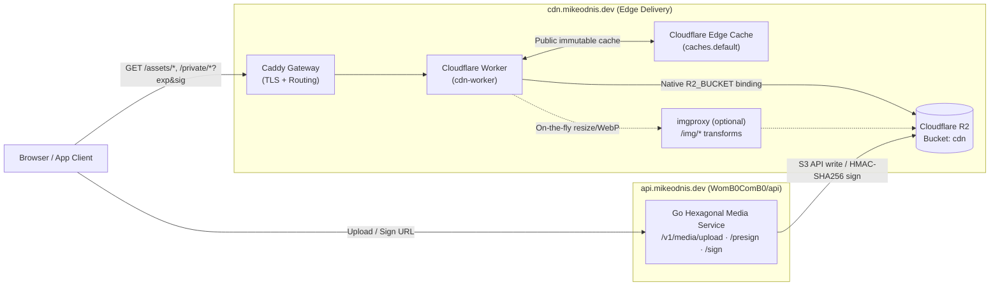
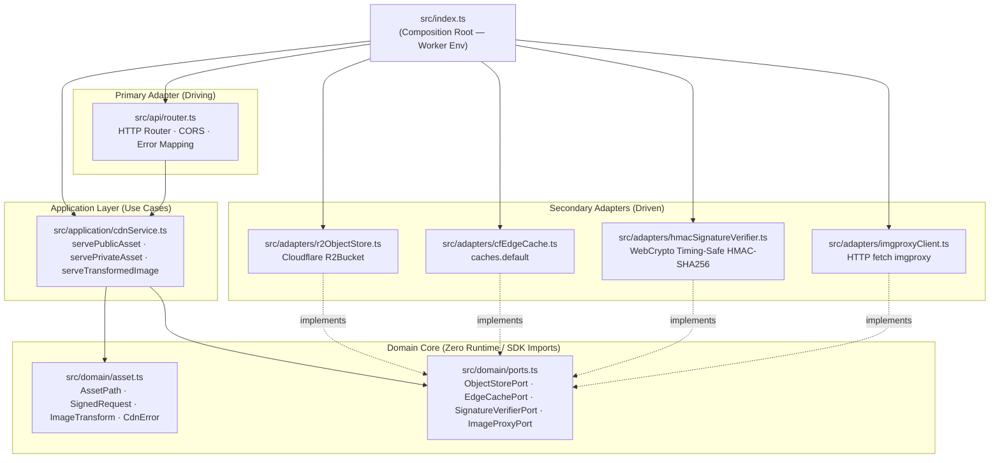
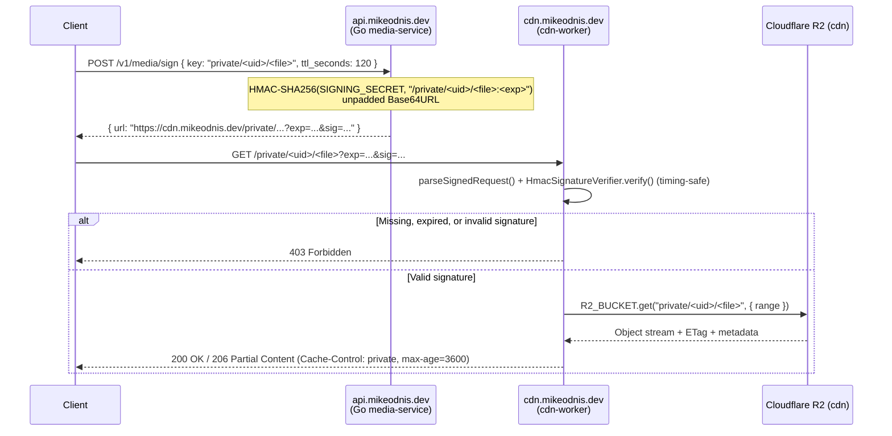

# cdn.mikeodnis.dev

Edge CDN for `mikeodnis.dev` powered by **Cloudflare Workers** + **Cloudflare R2**, structured with **Hexagonal Architecture (Ports & Adapters)** in strict TypeScript and paired with the backend control plane at [`WomB0ComB0/api`](https://github.com/WomB0ComB0/api) (`api.mikeodnis.dev`).

> **Single Source of Truth**: Core Auth (`core-service`), Go Hexagonal Media uploads/signing (`media-service`), Hasura GraphQL, and the Caddy reverse proxy (`gateway`) live in [`WomB0ComB0/api`](https://github.com/WomB0ComB0/api). This repository owns the **Edge CDN Worker**, R2 static upload scripts, and optional `imgproxy` transform container.

---

## Architecture

### Edge & Control Plane Topology



### Worker Hexagonal Architecture (Ports & Adapters)

Mirrors [`WomB0ComB0/go-hexagonal`](https://github.com/WomB0ComB0/go-hexagonal) and `api/services/media`, enforced automatically by `src/__tests__/architecture.test.ts`:



### Signed Private Asset Flow (`/private/*`)



---

## Routes

| Route | Methods | Behavior |
| :--- | :--- | :--- |
| `/health` | `GET` | Worker liveness check (`{"status":"healthy","service":"cdn-worker"}`) |
| `/assets/<key>` | `GET`, `HEAD`, `OPTIONS` | Public immutable R2 delivery (`Cache-Control: public, max-age=31536000, immutable`), Edge Cache (`caches.default`), `ETag` / `304`, and `Range` / `206` |
| `/private/<key>?exp=&sig=` | `GET`, `HEAD`, `OPTIONS` | Timing-safe HMAC-SHA256 signed private R2 delivery (compatible with `api.mikeodnis.dev` `POST /v1/media/sign`), bypasses shared edge cache |
| `/img/<key>?w=&h=&q=&f=` | `GET`, `HEAD`, `OPTIONS` | On-the-fly image transforms via `imgproxy` (blocks `private/*` keys, clamps dimensions `0–4096` and quality `10–100`) |

---

## Quick Start

### Prerequisites
- [Bun](https://bun.sh) (v1.2+)
- Cloudflare account with R2 bucket `cdn`

### Local Development & Testing

```bash
cd cloudflare-worker
bun install
bun run typecheck   # Strict TypeScript check
bun test            # Unit tests + Hexagonal architecture boundary checks
bun run dev         # Local Wrangler dev server
```

### Production Deployment

```bash
cd cloudflare-worker
bunx wrangler secret put SIGNING_SECRET   # Must match api.mikeodnis.dev SIGNING_SECRET
bunx wrangler deploy
```

CI automatically runs `bun run typecheck`, `bun test`, and `bunx wrangler deploy` on pushes to `main` touching `cloudflare-worker/**` (requires `CLOUDFLARE_API_TOKEN` in GitHub repository secrets).

---

## Directory Layout

```text
cdn/
├── cloudflare-worker/
│   ├── src/
│   │   ├── domain/
│   │   │   ├── asset.ts                  # Pure value objects, sanitization, CdnError
│   │   │   └── ports.ts                  # Outbound port interfaces
│   │   ├── application/
│   │   │   └── cdnService.ts             # Use cases (public, private, imgproxy)
│   │   ├── adapters/
│   │   │   ├── r2ObjectStore.ts          # Cloudflare R2Bucket adapter
│   │   │   ├── cfEdgeCache.ts            # Cloudflare caches.default adapter
│   │   │   ├── hmacSignatureVerifier.ts  # WebCrypto timing-safe HMAC-SHA256
│   │   │   └── imgproxyClient.ts         # HTTP imgproxy adapter
│   │   ├── api/
│   │   │   └── router.ts                 # Primary HTTP adapter + CORS
│   │   ├── __tests__/
│   │   │   ├── cdn.test.ts               # End-to-end Worker behavior tests
│   │   │   └── architecture.test.ts      # Hexagonal import-boundary enforcement
│   │   └── index.ts                      # Composition root
│   ├── wrangler.jsonc
│   ├── tsconfig.json
│   └── package.json
├── scripts/
│   ├── generate-asset-manifest.js        # Content-hash manifest generator
│   └── upload-to-r2.js                   # Bulk static R2 uploader
├── docker-compose.yml                    # Optional local/self-hosted imgproxy
├── Makefile
└── .env.example
```

## License

Apache-2.0
