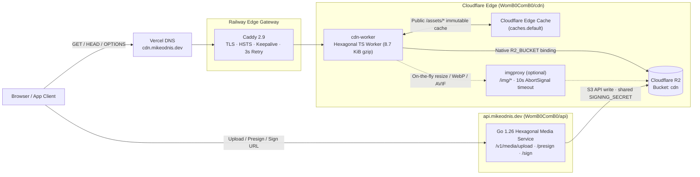
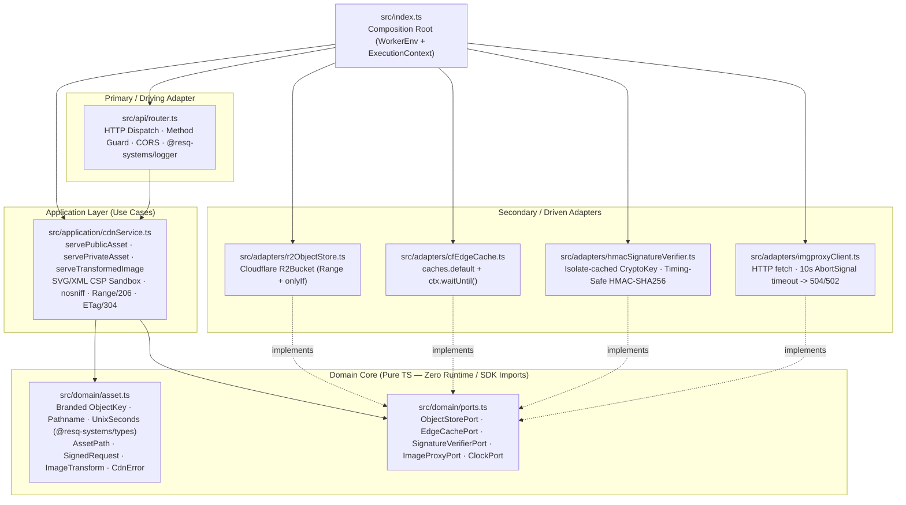
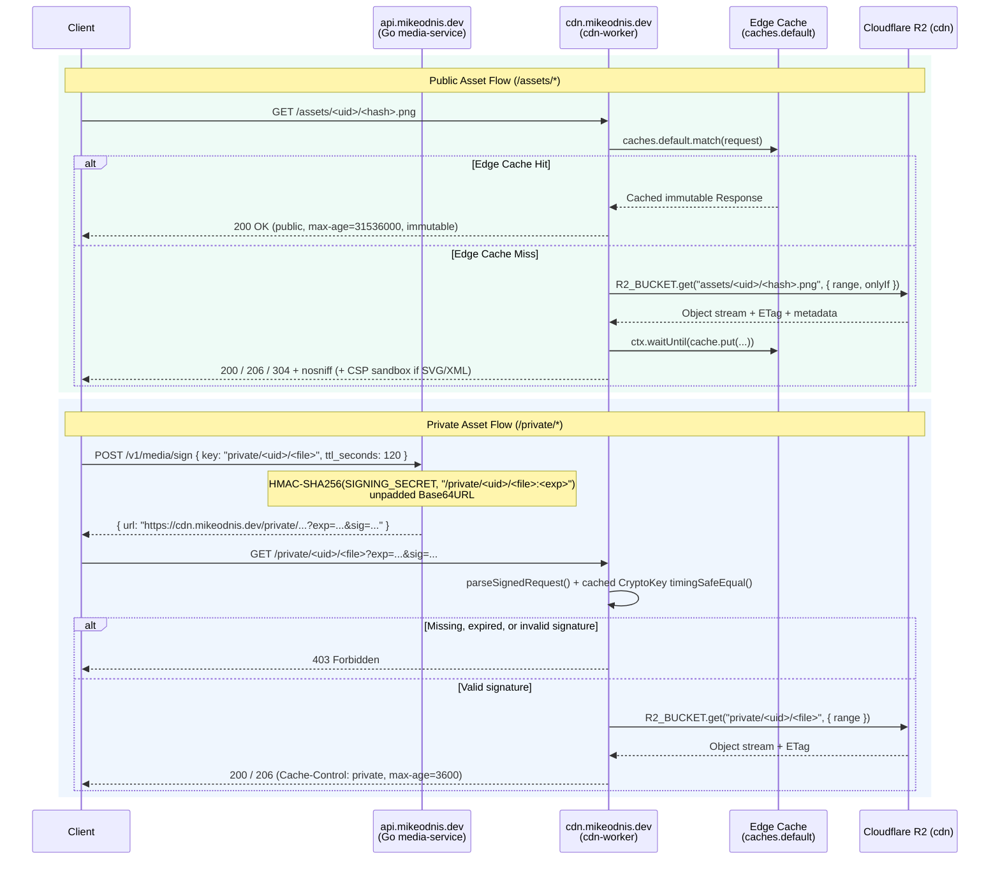
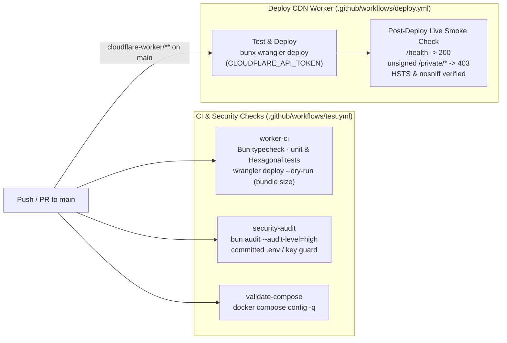

# Edge CDN — `cdn.mikeodnis.dev`

Production Edge CDN for `mikeodnis.dev` powered by **Cloudflare Workers** + **Cloudflare R2**, architected with **Hexagonal Architecture (Ports & Adapters)** in strict TypeScript (`~8.7 KiB` gzipped), using [`@resq-systems/types`](https://github.com/resq-software/npm) & [`@resq-systems/logger`](https://github.com/resq-software/npm), and paired with the backend control plane [`WomB0ComB0/api`](https://github.com/WomB0ComB0/api) (`api.mikeodnis.dev`).

> **Single Source of Truth**: Core Auth (`core-service`), Go Hexagonal Media uploads & HMAC signing (`media-service`), Hasura GraphQL, and the Caddy TLS/routing gateway (`gateway`) live in [`WomB0ComB0/api`](https://github.com/WomB0ComB0/api). This repository is focused exclusively on the **Edge CDN Worker**, R2 static asset scripts, and the optional `imgproxy` transform container.

---

## System Topology (Edge + Control Plane)



---

## Worker Hexagonal Architecture (Ports & Adapters)

Mirrors [`WomB0ComB0/go-hexagonal`](https://github.com/WomB0ComB0/go-hexagonal) and `api/services/media`. Layer dependency boundaries are enforced automatically on every test run via [`cloudflare-worker/src/__tests__/architecture.test.ts`](./cloudflare-worker/src/__tests__/architecture.test.ts):

- `src/domain/*` has **zero** imports from `application/`, `adapters/`, `api/`, `node:*`, or `@cloudflare/*`.
- `src/application/*` depends **only** on `domain/` models & ports — never on concrete adapters or HTTP routing.



---

## Request Flows (Public Edge Cache vs. Signed Private Assets)



---

## Automated CI/CD Pipeline



Weekly grouped dependency PRs are managed automatically via [`.github/dependabot.yml`](./.github/dependabot.yml).

---

## Security & Performance Controls

| Control | Implementation | Protection / Benefit |
| :--- | :--- | :--- |
| **SVG / XML Stored XSS Sandboxing** | [`cdnService.ts`](./cloudflare-worker/src/application/cdnService.ts) | Emits `Content-Security-Policy: default-src 'none'; sandbox` on SVG/XML/HTML objects + `X-Content-Type-Options: nosniff` on every response |
| **Isolate-Cached HMAC Verification** | [`hmacSignatureVerifier.ts`](./cloudflare-worker/src/adapters/hmacSignatureVerifier.ts) | Caches WebCrypto `CryptoKey` per Worker isolate + verifies signatures with `crypto.subtle.timingSafeEqual` (zero timing leak, low CPU) |
| **Path Traversal & Prefix Isolation** | [`asset.ts`](./cloudflare-worker/src/domain/asset.ts) | Rejects malformed percent-encoding, `..`, and `\` (`400`); blocks `/img/private/*` (`403`); clamps dimensions (`0–4096`) and quality (`10–100`) |
| **Branded Domain Types** | [`@resq-systems/types`](https://github.com/resq-software/npm) | Nominal `ObjectKey`, `Pathname`, `UnixSeconds` brands + curried range guards (`isInRange`, `isNonEmptyString`) |
| **Bounded Upstream Timeout** | [`imgproxyClient.ts`](./cloudflare-worker/src/adapters/imgproxyClient.ts) | `AbortSignal.timeout(10_000)` prevents hung Worker isolates, mapping cleanly to `504 Gateway Timeout` / `502 Bad Gateway` |
| **O(1) Edge Delivery** | [`cfEdgeCache.ts`](./cloudflare-worker/src/adapters/cfEdgeCache.ts) + [`r2ObjectStore.ts`](./cloudflare-worker/src/adapters/r2ObjectStore.ts) | Non-blocking `ctx.waitUntil(cache.put(...))`, full `Range`/`206` streaming, `HEAD` without body reads, `ETag`/`304` conditional caching |
| **Zero-Vulnerability Bundle** | [`test.yml`](./.github/workflows/test.yml) | Verified by `bun audit --audit-level=high` (`0` vulnerabilities) and compiled to `~8.7 KiB` gzipped |

---

## Routes

| Route | Methods | Behavior |
| :--- | :--- | :--- |
| `/health` | `GET` | Worker liveness check (`{"status":"healthy","service":"cdn-worker"}`) |
| `/assets/<key>` | `GET`, `HEAD`, `OPTIONS` | Public immutable R2 delivery (`public, max-age=31536000, immutable`), Edge Cache, `ETag`/`304`, `Range`/`206`, SVG CSP sandbox |
| `/private/<key>?exp=&sig=` | `GET`, `HEAD`, `OPTIONS` | Timing-safe HMAC-SHA256 signed private R2 delivery (compatible with `api.mikeodnis.dev` `POST /v1/media/sign`), bypasses shared edge cache |
| `/img/<key>?w=&h=&q=&f=` | `GET`, `HEAD`, `OPTIONS` | On-the-fly image transforms via `imgproxy` (blocks `private/*`, clamps `w`/`h`/`q`, allow-lists `webp`/`avif`/`jpg`/`jpeg`/`png`) |

---

## Quick Start

### Prerequisites
- [Bun](https://bun.sh) `1.4+`
- Cloudflare account with R2 bucket `cdn`

```bash
cd cloudflare-worker
bun install
bun run typecheck                  # Strict TypeScript check
bun test                           # Unit tests + Hexagonal boundary checks
bunx wrangler deploy --dry-run     # Verify Worker bundle size
bun run dev                        # Local Wrangler dev server
```

### Production Deployment

```bash
cd cloudflare-worker
bunx wrangler secret put SIGNING_SECRET   # Must match api.mikeodnis.dev SIGNING_SECRET
bunx wrangler deploy
```

Pushes to `main` touching `cloudflare-worker/**` automatically run typecheck, unit + Hexagonal tests, `wrangler deploy`, and live smoke verification via GitHub Actions (`CLOUDFLARE_API_TOKEN`).

---

## Directory Layout

```text
cdn/
├── .github/
│   ├── dependabot.yml                        # Weekly grouped updates (npm + actions)
│   └── workflows/
│       ├── test.yml                          # Typecheck, tests, dry-run bundle, bun audit
│       ├── deploy.yml                        # Production Worker deploy + live smoke test
│       └── upload-assets.yml                 # Bulk static R2 upload + manifest artifact
├── cloudflare-worker/
│   ├── src/
│   │   ├── domain/
│   │   │   ├── asset.ts                      # Branded value objects, sanitization, CdnError
│   │   │   └── ports.ts                      # Outbound port interfaces
│   │   ├── application/
│   │   │   └── cdnService.ts                 # Use cases + SVG CSP sandbox + CORS
│   │   ├── adapters/
│   │   │   ├── r2ObjectStore.ts              # Cloudflare R2Bucket adapter
│   │   │   ├── cfEdgeCache.ts                # Cloudflare caches.default adapter
│   │   │   ├── hmacSignatureVerifier.ts      # Isolate-cached timing-safe HMAC-SHA256
│   │   │   └── imgproxyClient.ts             # Bounded-timeout HTTP imgproxy adapter
│   │   ├── api/
│   │   │   └── router.ts                     # Primary HTTP adapter + @resq-systems/logger
│   │   ├── __tests__/
│   │   │   ├── cdn.test.ts                   # End-to-end Worker & security tests
│   │   │   └── architecture.test.ts          # Hexagonal import-boundary enforcement
│   │   └── index.ts                          # Composition root
│   ├── wrangler.jsonc
│   ├── tsconfig.json
│   └── package.json
├── scripts/
│   ├── generate-asset-manifest.ts            # Content-hash manifest generator (strict TS)
│   ├── upload-to-r2.ts                       # Bulk static R2 uploader (strict TS)
│   └── tsconfig.json                         # Maximum-strict TypeScript config
├── docker-compose.yml                        # Optional local/self-hosted imgproxy
├── Makefile
└── .env.example
```

## License

Apache-2.0
