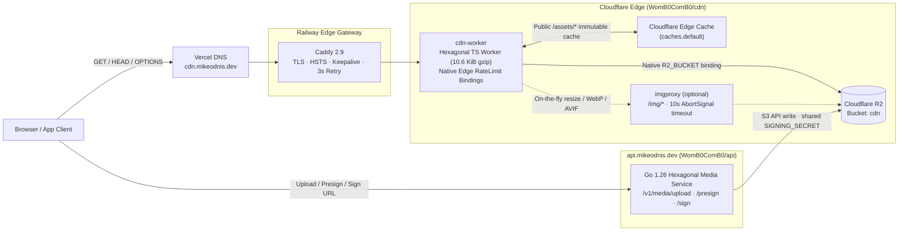
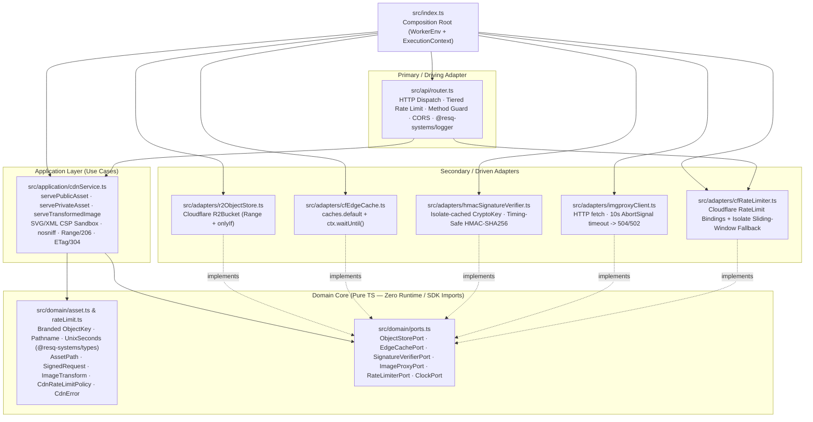
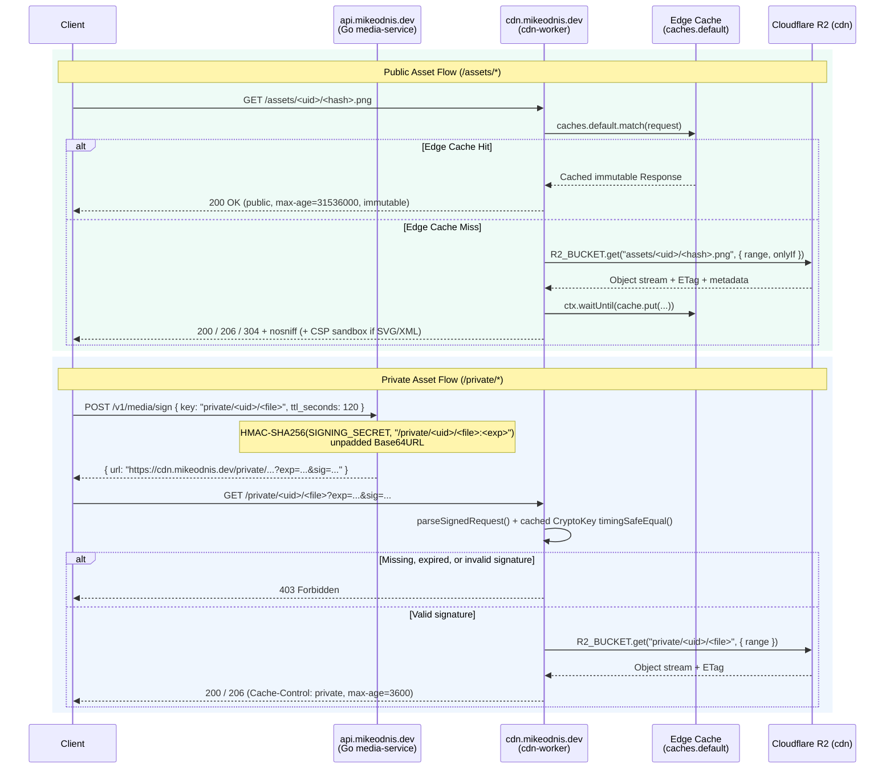
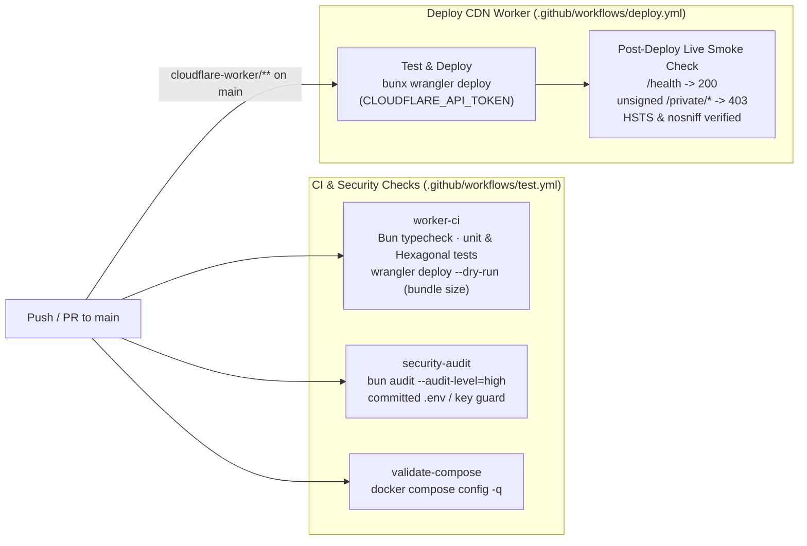

# Edge CDN — `cdn.mikeodnis.dev`

[](https://github.com/WomB0ComB0/cdn/actions/workflows/test.yml)
[](https://github.com/WomB0ComB0/cdn/releases)
[](LICENSE)

Production Edge CDN for `mikeodnis.dev` powered by **Cloudflare Workers** + **Cloudflare R2**, architected with **Hexagonal Architecture (Ports & Adapters)** in strict TypeScript, using [`@resq-systems/types`](https://github.com/resq-software/npm) & [`@resq-systems/logger`](https://github.com/resq-software/npm), native **Cloudflare Edge Rate Limiting bindings** + weighted sliding-window isolate fallback, Workers Logs & Traces observability, a **Live Console** base route + **Upload Studio PWA** (`/upload`), **Android TWA APK** + desktop CLI uploaders, LLM/AEO & RFC 9116 discovery endpoints, and paired with [`WomB0ComB0/api`](https://github.com/WomB0ComB0/api) (`api.mikeodnis.dev`).

> **Single Source of Truth**: Core Auth (`core-service`), Go Hexagonal Media uploads & HMAC signing (`media-service`), Hasura GraphQL, and the Caddy TLS/routing gateway (`gateway`) live in [`WomB0ComB0/api`](https://github.com/WomB0ComB0/api). This repository is focused exclusively on the **Edge CDN Worker**, R2 static asset scripts, and the optional `imgproxy` transform container.

---

## System Topology (Edge + Control Plane)



---

## Worker Hexagonal Architecture (Ports & Adapters)

Mirrors [`WomB0ComB0/go-hexagonal`](https://github.com/WomB0ComB0/go-hexagonal) and `api/services/media`. Layer dependency boundaries are enforced automatically on every test run via [`cloudflare-worker/src/__tests__/architecture.test.ts`](./cloudflare-worker/src/__tests__/architecture.test.ts):

- `src/domain/*` has **zero** imports from `application/`, `adapters/`, `api/`, `node:*`, or `@cloudflare/*`.
- `src/application/*` depends **only** on `domain/` models & ports — never on concrete adapters or HTTP routing.



---

## Request Flows (Public Edge Cache vs. Signed Private Assets)



---

## Automated CI/CD Pipeline



Weekly grouped dependency PRs are managed automatically via [`.github/dependabot.yml`](./.github/dependabot.yml) (`bun` + `github-actions`). All workflows are audited with `zizmor` (`0` findings) with 40-char commit SHA pinning and `persist-credentials: false`.

### SemVer Releases (`.github/workflows/release.yml`)

Pushing an annotated SemVer tag (`vX.Y.Z`) or triggering `workflow_dispatch` runs typecheck, unit + Hexagonal tests, `bun audit --audit-level=high`, builds a reproducible `cdn-worker-vX.Y.Z.tar.gz` + `SHA256SUMS.txt`, deploys to Cloudflare Workers production with live smoke verification, and publishes a GitHub Release with categorized notes ([`.github/release.yml`](./.github/release.yml)).

---

## Security & Performance Controls

| Control | Implementation | Protection / Benefit |
| :--- | :--- | :--- |
| **Tiered Edge Rate Limiting** | [`rateLimit.ts`](./cloudflare-worker/src/domain/rateLimit.ts) + [`cfRateLimiter.ts`](./cloudflare-worker/src/adapters/cfRateLimiter.ts) | Native Cloudflare `ratelimits` bindings (`/img/*` 60/60s, `/private/*` 120/60s, `/assets/*` 300/60s) keyed by non-spoofable `CF-Connecting-IP`, bounded weighted sliding-window isolate fallback, and IETF `RateLimit-*` + `Retry-After` headers |
| **SVG / XML Stored XSS Sandboxing** | [`cdnService.ts`](./cloudflare-worker/src/application/cdnService.ts) | Emits `Content-Security-Policy: default-src 'none'; sandbox` on SVG/XML/HTML objects + `X-Content-Type-Options: nosniff` on every response |
| **Isolate-Cached HMAC Verification** | [`hmacSignatureVerifier.ts`](./cloudflare-worker/src/adapters/hmacSignatureVerifier.ts) | Caches WebCrypto `CryptoKey` per Worker isolate + verifies signatures with `crypto.subtle.timingSafeEqual` (zero timing leak, low CPU) |
| **Path Traversal & Prefix Isolation** | [`asset.ts`](./cloudflare-worker/src/domain/asset.ts) | Rejects malformed percent-encoding, `..`, and `\` (`400`); blocks `/img/private/*` (`403`); clamps dimensions (`0–4096`) and quality (`10–100`) |
| **Branded Domain Types** | [`@resq-systems/types`](https://github.com/resq-software/npm) | Nominal `ObjectKey`, `Pathname`, `UnixSeconds` brands + curried range guards (`isInRange`, `isNonEmptyString`) |
| **Bounded Upstream Timeout** | [`imgproxyClient.ts`](./cloudflare-worker/src/adapters/imgproxyClient.ts) | `AbortSignal.timeout(10_000)` prevents hung Worker isolates, mapping cleanly to `504 Gateway Timeout` / `502 Bad Gateway` |
| **O(1) Edge Delivery** | [`cfEdgeCache.ts`](./cloudflare-worker/src/adapters/cfEdgeCache.ts) + [`r2ObjectStore.ts`](./cloudflare-worker/src/adapters/r2ObjectStore.ts) | Non-blocking `ctx.waitUntil(cache.put(...))`, full `Range`/`206` streaming, `HEAD` without body reads, `ETag`/`304` conditional caching |
| **Zero-Vulnerability Bundle** | [`test.yml`](./.github/workflows/test.yml) | Verified by `bun audit --audit-level=high` (`0` vulnerabilities), `zizmor` (`0` findings), and strict TypeScript + Hexagonal architecture boundary tests |
| **LLM / AEO & Standards Discovery** | [`discovery.ts`](./cloudflare-worker/src/api/discovery.ts) + [`brandAssets.ts`](./cloudflare-worker/src/api/brandAssets.ts) | Serves `/llms.txt`, `/llms-full.txt`, `/openapi.yaml`, `/.well-known/security.txt`, `/.well-known/assetlinks.json`, `/robots.txt`, `/sitemap.xml`, `Link` headers, Wolf-Mark icons, and 1200×630 OpenGraph cards (`CORP: cross-origin`) |

---

## Routes

### Asset Delivery & Health

| Route | Methods | Rate Limit | Behavior |
| :--- | :--- | :--- | :--- |
| `/health` | `GET` | Exempt | Worker liveness check (`{"status":"healthy","service":"cdn-worker"}`) |
| `/health/metrics` | `GET` | Exempt | Worker liveness + rate-limiter observability metrics (`evaluated`, `limited429`, `limitedByTier`, `bindingErrors`, `isolateFallbackHits`) |
| `/assets/<key>` | `GET`, `HEAD`, `OPTIONS` | `300 / 60s` | Public immutable R2 delivery (`public, max-age=31536000, immutable`), Edge Cache, `ETag`/`304`, `Range`/`206`, SVG CSP sandbox |
| `/private/<key>?exp=&sig=` | `GET`, `HEAD`, `OPTIONS` | `120 / 60s` | Timing-safe HMAC-SHA256 signed private R2 delivery (compatible with `api.mikeodnis.dev` `POST /v1/media/sign`), bypasses shared edge cache |
| `/img/<key>?w=&h=&q=&f=` | `GET`, `HEAD`, `OPTIONS` | `60 / 60s` | On-the-fly image transforms via `imgproxy` (blocks `private/*`, clamps `w`/`h`/`q`, allow-lists `webp`/`avif`/`jpg`/`jpeg`/`png`) |

### Portal, Upload Studio PWA, Discovery & Brand Assets

| Route | Methods | Behavior |
| :--- | :--- | :--- |
| `/` | `GET`, `HEAD` | Content-negotiated: Live Console HTML docs + live `/health/metrics` + JSON-LD (`SoftwareApplication`, `FAQPage`) for browsers; JSON service descriptor for `Accept: application/json` clients |
| `/upload` | `GET`, `HEAD` | Installable **Upload Studio PWA** (JWT login + refresh rotation or Bearer token, drag-and-drop, camera capture, clipboard paste, Android Share Sheet receiver, public/private uploads, 1-tap signed URLs & asset manager) |
| `/manifest.webmanifest`, `/sw.js` | `GET`, `HEAD` | PWA manifest with **Web Share Target API** (`POST /upload-share`) + Service Worker handoff |
| `/llms.txt`, `/llms-full.txt`, `/openapi.yaml` | `GET`, `HEAD` | Concise and full LLM/AEO guides + OpenAPI 3.1 contract |
| `/.well-known/security.txt`, `/robots.txt`, `/sitemap.xml` | `GET`, `HEAD` | RFC 9116 disclosure policy, explicit AI crawler rules (`GPTBot`, `OAI-SearchBot`, `ClaudeBot`, `PerplexityBot`), XML sitemap |
| `/.well-known/assetlinks.json` | `GET`, `HEAD` | Android Digital Asset Links verifying the `dev.mikeodnis.cdn` TWA APK |
| `/favicon.ico`, `/icon.svg`, `/apple-touch-icon.png`, `/icon-192.png`, `/icon-512.png` | `GET`, `HEAD` | Live Console Wolf-Mark favicons, Apple Touch icon, and maskable PWA icons (`CORP: cross-origin`) |
| `/opengraph-image`, `/opengraph-image.png`, `/twitter-image`, `/twitter-image.png` | `GET`, `HEAD` | 1200×630 Live Console OpenGraph & Twitter `summary_large_image` social preview cards (`CORP: cross-origin`) |

---

## Upload Anywhere (Web/Mobile PWA, Android APK & Desktop CLI)

### 1. Web & Mobile PWA (zero install build)
Open **`https://cdn.mikeodnis.dev/upload`** on Android Chrome, iOS Safari, or Desktop Chromium and choose **Install app** / **Add to Home Screen**. Supports camera capture, clipboard paste, drag-and-drop, and Android Share Sheet handoff.

### 2. Sideloadable Android TWA APK (`dev.mikeodnis.cdn`)
Builds a signed, zipaligned Trusted Web Activity APK wrapping `https://cdn.mikeodnis.dev/upload` with native Android Share Sheet integration and full-screen Digital Asset Links verification (requires JDK 17/21, Android SDK with `platforms/android-36`, and Bun):

```bash
./scripts/build-android-apk.sh
# Outputs: ./android-twa/mike-cdn-upload.apk (gitignored)
# Local release keystore stored at ~/.config/mike-cdn/android-upload.keystore (chmod 600, gitignored)
adb install -r ./android-twa/mike-cdn-upload.apk
```

### 3. Desktop / Terminal CLI (Bun)
Upload files from any terminal with persistent JWT refresh (`~/.config/mike-cdn/session.json`, `chmod 600`) and automatic clipboard copy (`wl-copy` / `xclip` / `pbcopy`):

```bash
bun run scripts/cdn-upload.ts login <your-email>
bun run scripts/cdn-upload.ts ./screenshot.png --copy
bun run scripts/cdn-upload.ts ./invoice.pdf --private --sign 3600 --copy
```

---

## Quick Start

### Prerequisites
- [Bun](https://bun.sh) `1.4+`
- Cloudflare account with R2 bucket `cdn`

```bash
cd cloudflare-worker
bun install
bun run typecheck                  # Strict TypeScript check
bun test                           # Unit tests + Hexagonal boundary checks
bunx wrangler deploy --dry-run     # Verify Worker bundle size
bun run dev                        # Local Wrangler dev server
```

### Production Deployment

```bash
cd cloudflare-worker
bunx wrangler secret put SIGNING_SECRET   # Must match api.mikeodnis.dev SIGNING_SECRET
bunx wrangler deploy
```

Pushes to `main` touching `cloudflare-worker/**` automatically run typecheck, unit + Hexagonal tests, `wrangler deploy`, and live smoke verification via GitHub Actions (`CLOUDFLARE_API_TOKEN`).

---

## Directory Layout

```text
cdn/
├── .github/
│   ├── dependabot.yml                        # Weekly grouped updates (bun + actions)
│   ├── release.yml                           # Categorized GitHub release notes config
│   └── workflows/
│       ├── test.yml                          # Typecheck, tests, dry-run bundle, bun audit, zizmor
│       ├── deploy.yml                        # Production Worker deploy + live smoke test
│       ├── release.yml                       # SemVer release workflow + checksums + deploy
│       └── upload-assets.yml                 # Bulk static R2 upload + manifest artifact
├── cloudflare-worker/
│   ├── src/
│   │   ├── domain/
│   │   │   ├── asset.ts                      # Branded value objects, sanitization, CdnError
│   │   │   ├── rateLimit.ts                  # Pure tiered rate-limit policies & IETF headers
│   │   │   └── ports.ts                      # Outbound port interfaces (incl. RateLimiterPort)
│   │   ├── application/
│   │   │   └── cdnService.ts                 # Use cases + SVG CSP sandbox + CORS
│   │   ├── adapters/
│   │   │   ├── r2ObjectStore.ts              # Cloudflare R2Bucket adapter
│   │   │   ├── cfEdgeCache.ts                # Cloudflare caches.default adapter
│   │   │   ├── cfRateLimiter.ts              # Cloudflare RateLimit bindings + isolate fallback
│   │   │   ├── hmacSignatureVerifier.ts      # Isolate-cached timing-safe HMAC-SHA256
│   │   │   └── imgproxyClient.ts             # Bounded-timeout HTTP imgproxy adapter
│   │   ├── api/
│   │   │   ├── router.ts                     # Primary HTTP adapter + rate limit + @resq-systems/logger
│   │   │   ├── pages.ts                      # Live Console landing page, Upload Studio PWA, manifest & sw.js
│   │   │   ├── discovery.ts                  # llms.txt, llms-full.txt, openapi.yaml, security.txt, assetlinks.json
│   │   │   └── brandAssets.ts                # Embedded Wolf-Mark icons & 1200×630 OpenGraph PNG assets
│   │   ├── __tests__/
│   │   │   ├── cdn.test.ts                   # End-to-end Worker & security tests
│   │   │   ├── discovery.test.ts             # Portal, PWA, brand assets & LLM/security discovery tests
│   │   │   ├── rateLimit.test.ts             # Edge binding & sliding-window fallback tests
│   │   │   └── architecture.test.ts          # Hexagonal import-boundary enforcement
│   │   └── index.ts                          # Composition root
│   ├── wrangler.jsonc
│   ├── tsconfig.json
│   └── package.json
├── scripts/
│   ├── cdn-upload.ts                         # Terminal/desktop CLI uploader with JWT refresh & clipboard copy
│   ├── build-android-apk.sh                  # Non-interactive Android TWA APK builder (JDK 17/21 + SDK 36)
│   ├── generate-asset-manifest.ts            # Content-hash manifest generator (strict TS)
│   ├── upload-to-r2.ts                       # Bulk static R2 uploader (strict TS)
│   └── tsconfig.json                         # Maximum-strict TypeScript config
├── docker-compose.yml                        # Optional local/self-hosted imgproxy
├── Makefile
└── .env.example
```

## License

Apache-2.0
